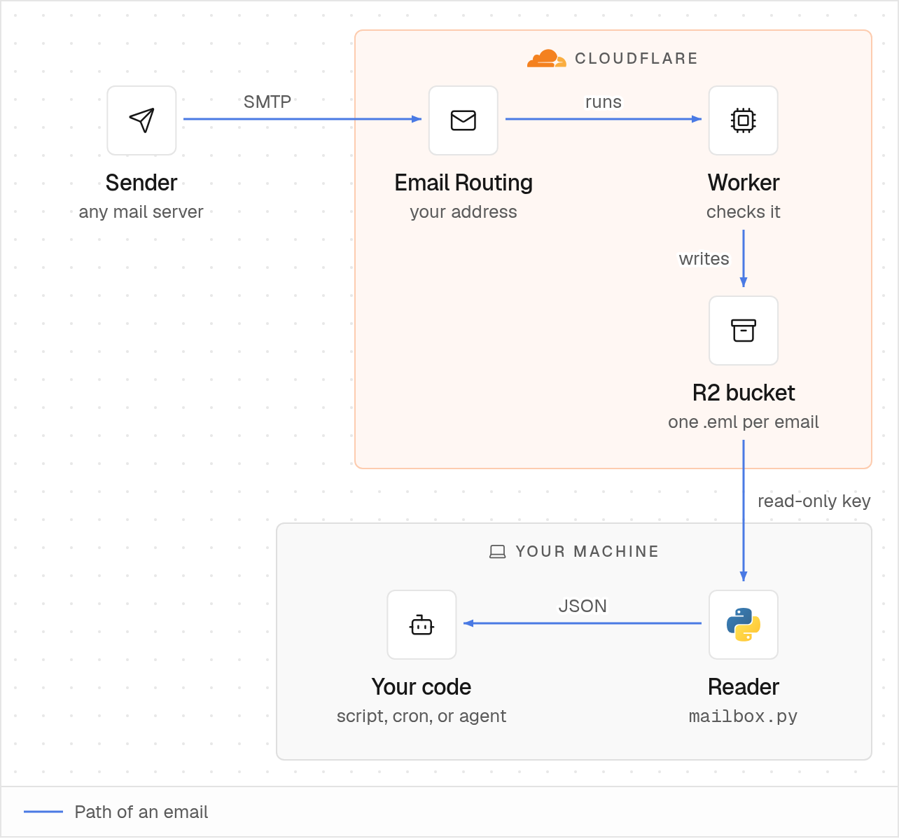

# r2-mailbox

r2-mailbox gives you an email address on your own domain that saves every email it gets into a Cloudflare R2 bucket. You can then read those emails from a script, a cron job, or an AI agent, using a key that can only read that one bucket.

I built it so an agent could have its own inbox for newsletters. It reads the day’s issues and picks out what is worth reading, without ever touching my personal email. It works for anything else you want to handle in code too: signup confirmations, alerts, receipts, reports.

It uses three Cloudflare pieces:

- Email Routing receives mail for your address.
- A small Worker saves each email to R2.
- An R2 bucket stores the emails as plain `.eml` files.

<picture data-diagram="mail-flow">
  <source media="(prefers-color-scheme: dark)" srcset="docs/images/mail-flow-dark.png">
  
</picture>

## Documentation

The [docs](docs/README.md) cover setup, everyday use, and every setting in detail:

- [Set up your inbox on Cloudflare](docs/getting-started.md): the full step-by-step tutorial
- [Set up your inbox with an AI agent](docs/setup-with-an-ai-agent.md): a copy-paste prompt that has a coding agent run the tutorial for you
- [Read your mail from the command line](docs/reading-mail.md): list, show, download, and export emails, or use any S3 tool
- [Send your mail to a script or AI agent](docs/agents-and-scripts.md): scheduled exports, reading the JSON, and keeping an agent safe from hostile emails
- [Control which emails your inbox accepts and keeps](docs/managing-your-inbox.md): sender limits, DMARC, forwarding, retention, key rotation, and deleting emails
- [How r2-mailbox works](docs/how-it-works.md): the design, the storage format, and what it costs
- [Fix setup and delivery problems](docs/troubleshooting.md)
- Reference: [reader](docs/reference/reader.md) and [Worker and setup script](docs/reference/worker.md)

## How it stays private

The Worker only has an email handler. It has no web URL, no preview URLs, and no routes, so nobody on the internet can call it. Only Email Routing can send it mail.

To read mail you create an R2 key that can only read objects in this one bucket. It cannot write, delete, or see anything else in your Cloudflare account. If the key leaks, the worst case is someone reads the emails in that bucket.

The Worker has no secrets of its own. It writes to R2 through a binding, which Cloudflare handles for you. [How r2-mailbox works](docs/how-it-works.md) explains the design in more detail.

## What you need

To run r2-mailbox you need:

- A Cloudflare account. The free plan works.
- A domain with its DNS on Cloudflare. A `*.workers.dev` or `*.pages.dev` address cannot receive email.
- R2 turned on for your account. You do this once in the dashboard under R2.
- Node.js 20 or newer, for Wrangler (Cloudflare’s command-line tool).
- Python 3.9 or newer for the reader. It uses only the standard library, so there is nothing to install.

One warning before you start. If your domain already gets email somewhere else, like Google Workspace or Fastmail, do not turn on Email Routing for the main domain. It replaces your mail exchanger (MX) records and your normal email will stop arriving. Use a subdomain instead, like `mail.yourdomain.com`.

## Set up in six steps

Setup takes about 15 minutes. This is the short version; the [setup tutorial](docs/getting-started.md) explains every step and what to do if one fails.

1. Get the code and log in:

   ```bash
   git clone https://github.com/hdprajwal/r2-mailbox.git
   cd r2-mailbox
   npm install
   npx wrangler login
   ```

2. In the Cloudflare dashboard, open your domain, go to **Email** > **Email Routing**, and click **Get started**.

3. Create the bucket, add a rule that deletes emails after 30 days, and deploy the Worker:

   ```bash
   npm run setup
   ```

4. In **Email Routing** > **Routing rules**, create an address like `inbox@yourdomain.com` with the action **Send to a Worker** and pick `r2-mailbox`.

5. Under **R2** > **Manage API tokens**, create a token with **Object Read only** on the `r2-mailbox` bucket only. Copy its 32-character Access Key ID and 64-character Secret Access Key into a private config file:

   ```bash
   mkdir -p ~/.config/r2-mailbox
   cp config.example.json ~/.config/r2-mailbox/config.json
   chmod 600 ~/.config/r2-mailbox/config.json
   ```

   Fill in `account_id`, `access_key_id`, and `secret_access_key`, then run `npm run check`.

6. Send an email to your new address, wait a few seconds, and run:

   ```bash
   python3 reader/mailbox.py list --hours 1
   ```

You should see the email you sent. If not, see [Nothing shows up after a test email](docs/troubleshooting.md#nothing-shows-up-after-a-test-email).

## Reading mail

The reader has five commands:

```bash
python3 reader/mailbox.py list   --hours 24            # one line per email
python3 reader/mailbox.py show   <key>                 # headers, text, links
python3 reader/mailbox.py get    <key> -o email.eml    # the raw email file
python3 reader/mailbox.py export --hours 24 -o mail.json
python3 reader/mailbox.py check                        # test the key
```

`export` is the one you want for scripts and agents. It writes a JSON file with one entry per email, including the sender, subject, DMARC result, links, and text. [Read your mail from the command line](docs/reading-mail.md) covers each command, and the [reader reference](docs/reference/reader.md#export-format) lists every field.

## Things to keep in mind

Anyone who knows the address can send email to it. Treat what is inside the emails as untrusted, especially if an AI agent reads them. An email can contain text written to trick an agent into doing something. If you only expect mail from a few senders, set `ALLOWED_SENDERS`. [Send your mail to a script or AI agent](docs/agents-and-scripts.md#pass-mail-to-an-ai-agent-safely) has more on this.

Signup confirmation emails land in the bucket like any other email. The reader never opens links on its own. Whether your code should open them is up to you. Opening them by hand is the safe choice.

## Cost

Email Routing is free. A personal inbox uses little Worker time and storage, so it should fit inside the free plans for Workers and R2. [What r2-mailbox costs to run](docs/how-it-works.md#what-r2-mailbox-costs-to-run) breaks down what each email and each reader command uses.

## Working on the code

The npm scripts type-check, deploy, and watch the Worker:

```bash
npm install
npm run typecheck    # type-check the Worker against Cloudflare's types
npm run deploy       # deploy the Worker
npm run tail         # watch the Worker's logs live
```

[Change and deploy the code](docs/development.md) explains how to test changes and lists what each file in the repo does.

## Security

If you find a security problem, please report it privately. See [SECURITY.md](SECURITY.md).

## License

MIT. See [LICENSE](LICENSE).
