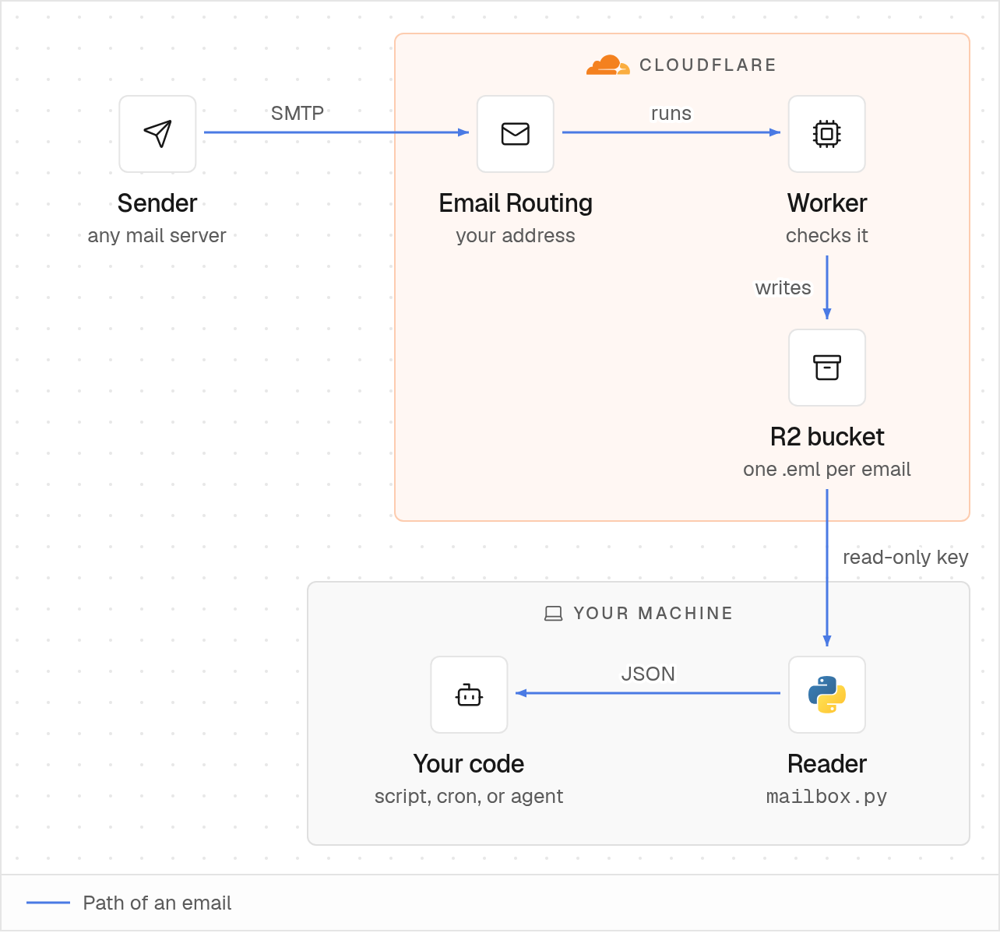

# Set up your inbox on Cloudflare

This tutorial takes you from a Cloudflare account to an email address that saves every email it gets into an R2 bucket, plus a key that can only read that bucket. It takes about 15 minutes. At the end you’ll send yourself a test email and read it back from the command line.

To have an AI coding agent run these steps for you, use the prompt in [Set up your inbox with an AI agent](setup-with-an-ai-agent.md).

By the end, an email to your address takes this path, and you’ll have set up every part of it:

<picture data-diagram="mail-flow">
  <source media="(prefers-color-scheme: dark)" srcset="images/mail-flow-dark.png">
  
</picture>

## What you need before you start

The setup runs on Cloudflare’s free plan. You’ll need:

- A Cloudflare account. The free plan works.
- A domain with its DNS on Cloudflare. A `*.workers.dev` or `*.pages.dev` address can’t receive email.
- R2 turned on for your account. You do this once in the dashboard under **R2**.
- Node.js 20 or newer, to run Wrangler, Cloudflare’s command-line tool.
- Python 3.9 or newer, to run the reader. It uses only the Python standard library, so you don’t install anything for it.
- `git` and `curl`.

## Choose a domain that won’t break your existing email

Email Routing replaces the mail exchanger (MX) records on the domain you turn it on for, so all email for that domain goes to Cloudflare. If your domain already gets email through a provider like Google Workspace or Fastmail, turning on Email Routing for it stops your normal email from arriving.

In that case, use a subdomain such as `mail.yourdomain.com`. You add one in the dashboard under **Email Routing** > **Settings** > **Subdomains**. The rest of this tutorial works the same for a subdomain.

## Step 1: Get the code and log in

Clone the repo, install the pinned tools, and log in to Cloudflare:

```bash
git clone https://github.com/hdprajwal/r2-mailbox.git
cd r2-mailbox
npm install
npx wrangler login
```

`npm install` installs a pinned version of Wrangler and the Cloudflare type definitions. The setup script uses that Wrangler when it’s there, and falls back to the latest version from npm when it isn’t. `wrangler login` opens a browser window so you can approve access to your account.

If your login has more than one Cloudflare account, run `npx wrangler whoami` to list them. Then either set `account_id` in `worker/wrangler.jsonc` or export `CLOUDFLARE_ACCOUNT_ID` in your shell, so Wrangler knows which account to use.

## Step 2: Turn on Email Routing

Email Routing is the Cloudflare service that receives mail for your domain. You turn it on once per domain:

1. In the Cloudflare dashboard, open your domain.
2. Go to **Email** > **Email Routing**.
3. Click **Get started**.

Cloudflare adds the DNS records that Email Routing needs. If the domain already uses Email Routing, skip this step.

## Step 3: Create the bucket and deploy the Worker

The setup script creates the storage and deploys the code in one command:

```bash
npm run setup
```

This runs `scripts/setup.sh`, which does three things:

1. Creates an R2 bucket called `r2-mailbox`. If the bucket already exists, the script reuses it.
2. Adds a lifecycle rule that deletes stored emails 30 days after they arrive.
3. Deploys the Worker, also called `r2-mailbox`.

Each part prints a line starting with `==>`, with Wrangler’s own output in between. The script then prints two reminders: one for the routing rule, which you’ll set up in step 4, and one for the read key, which you’ll create in step 5.

You can change two things with environment variables:

- **`RETENTION_DAYS`**: the number of days to keep emails. Set it to `0` to keep them forever.
- **`BUCKET`**: a different bucket name. Change `bucket_name` in `worker/wrangler.jsonc` to match first, or the script stops with an error.

For example, to keep emails for 90 days in a bucket called `my-inbox`:

```bash
BUCKET=my-inbox RETENTION_DAYS=90 ./scripts/setup.sh
```

The script is safe to run again. It reuses the bucket, redeploys the Worker, and leaves an existing routing rule as it is.

## Step 4: Send an address to the Worker

A routing rule tells Email Routing which address belongs to the Worker. You can create it in the dashboard or let the setup script create it.

To use the dashboard:

1. Go to **Email Routing** > **Routing rules** > **Create address**.
2. Under **Custom address**, type the address you want, like `inbox@yourdomain.com`.
3. Under **Action**, choose **Send to a Worker** and pick `r2-mailbox`.
4. Save the rule.

To use the script instead, you need two more values:

- An API token with the **Email Routing Rules: Edit** permission on the domain. Create one under **My Profile** > **API Tokens**.
- The domain’s zone ID, shown on the domain’s **Overview** page.

Then run the script again with the address, zone ID, and token:

```bash
ADDRESS=inbox@yourdomain.com \
ZONE_ID=your_zone_id_here \
CLOUDFLARE_API_TOKEN=your_api_token_here \
./scripts/setup.sh
```

The script checks that Email Routing is on for the domain before it creates the rule. If a rule for that address already exists, the script leaves it alone and prints `a rule for … already exists`.

## Step 5: Create a read-only key

The reader needs an R2 key to download emails. Give it a key that can only read this one bucket, so a leaked key can’t do more than read your email.

1. In the dashboard, go to **R2** > **Manage API tokens** > **Create API token**.
2. Set **Permission** to **Object Read only**.
3. Limit the token to the `r2-mailbox` bucket only.
4. Create the token.

The next page shows several values. You need two of them:

- **Access Key ID**: 32 characters
- **Secret Access Key**: 64 characters

Don’t use the token value that starts with `cf`. It’s a Cloudflare API token, and it won’t work as an Access Key ID. Copy the Secret Access Key now, because the dashboard only shows it once.

Next, create a config file that only your user can read:

```bash
mkdir -p ~/.config/r2-mailbox
cp config.example.json ~/.config/r2-mailbox/config.json
chmod 600 ~/.config/r2-mailbox/config.json
```

Open `~/.config/r2-mailbox/config.json` and fill in your values:

```json
{
  "account_id": "your_account_id_here",
  "bucket": "r2-mailbox",
  "access_key_id": "your_access_key_id_here",
  "secret_access_key": "your_secret_access_key_here",
  "prefix": "mail"
}
```

Your account ID is on the right side of the dashboard home page, and in the output of `npx wrangler whoami`. If you used a different bucket name in step 3, put that name in `bucket`.

Check that the reader can reach the bucket:

```bash
python3 reader/mailbox.py check
```

You should see `ok: can list bucket 'r2-mailbox', 0 message(s) under mail/`. If you see `R2 returned 403` instead, the key is wrong or isn’t allowed to read this bucket. See [Fix setup and delivery problems](troubleshooting.md#the-reader-says-r2-returned-403).

## Step 6: Send a test email and read it back

Send any email to your new address from another account. Wait a few seconds, then list the emails from the last hour:

```bash
python3 reader/mailbox.py list --hours 1
```

You’ll see one line for your email, with the time it arrived, the sender, the subject, and the email’s key in square brackets. Copy the key and open the email:

```bash
python3 reader/mailbox.py show mail/2026-11-17/your_email_key_here.eml
```

`show` prints the headers, the text of the email, and the links in it. If you see your test email, your inbox works.

If nothing shows up, see [Nothing shows up after a test email](troubleshooting.md#nothing-shows-up-after-a-test-email).

## Next steps

Your inbox is ready. From here you can:

- [Read your mail from the command line](reading-mail.md), including JSON export
- [Send your mail to a script or AI agent](agents-and-scripts.md) on a schedule
- [Limit who can send to your address](managing-your-inbox.md#accept-email-only-from-senders-you-expect), which matters if an agent reads your mail
- [Learn how the parts fit together](how-it-works.md)
