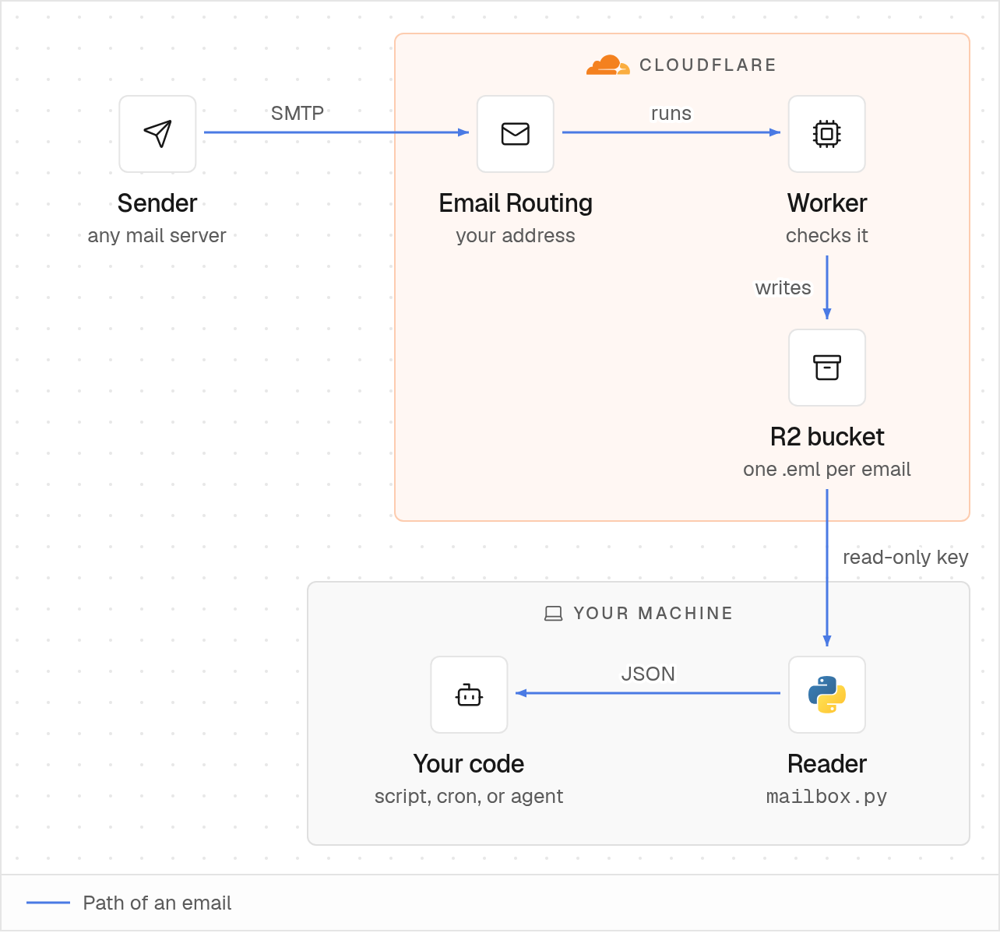

# How r2-mailbox works

r2-mailbox joins three Cloudflare services: Email Routing receives mail for your address, a small Worker saves each email, and an R2 bucket stores the emails as files. This page explains what happens to an email from the moment someone sends it, why nobody on the internet can call the Worker, how the emails are stored, and what it costs to run.

## What happens when someone sends you an email

Each email goes through the same six steps, from the sender’s mail server to your script:

1. The sender’s mail server looks up the mail exchanger (MX) records for your domain and connects to Cloudflare.
2. Email Routing checks the email. If it fails DMARC and the sender’s domain asks for failing mail to be rejected or quarantined, Email Routing drops it here.
3. Email Routing finds the routing rule for your address and runs the `r2-mailbox` Worker.
4. The Worker checks the size, the sender, and optionally the DMARC result. If a check fails, it rejects the email with a permanent error, and the sender’s server gets a bounce.
5. The Worker writes the email to R2 as one `.eml` file, exactly as it arrived. If you set `FORWARD_TO`, it also forwards a copy.
6. Later, the reader on your machine lists and downloads emails through R2’s S3-compatible API, using a read-only key, and parses them locally.

<picture data-diagram="mail-flow">
  <source media="(prefers-color-scheme: dark)" srcset="images/mail-flow-dark.png">
  
</picture>

DMARC stands for Domain-based Message Authentication, Reporting, and Conformance. It’s the check that shows an email came from the domain in its `From` address.

## Why nobody can call the Worker from the internet

The Worker has no web address, so the only way to run it is to send an email to a routed address. Its code has an `email` handler and no `fetch` handler, so it has nothing to answer a web request with.

Its config in `worker/wrangler.jsonc` also turns off every way of giving it a URL:

- **`workers_dev: false`**: no `*.workers.dev` address
- **`preview_urls: false`**: no preview URLs for new versions
- No `routes`, so it isn’t attached to any of your domains

The Worker also has no secrets. It writes to R2 through a binding called `MAILBOX`, which Cloudflare sets up when you deploy. There’s no key in the code or the config to leak.

## What the read key can and can’t do

Because the reader runs on your machine, it needs a key, and r2-mailbox asks you to create one with the least access that still works. The key has the **Object Read only** permission on one bucket. With it, someone can list and download the emails in that bucket.

The key can’t write or delete emails, and it can’t see other buckets or anything else in your Cloudflare account. If it leaks, the worst case is that someone reads the emails in that bucket until you delete the key. See [Rotate the read key](managing-your-inbox.md#rotate-the-read-key).

## Why the Worker saves emails without parsing them

Parsing an email takes CPU time, and the Workers free plan allows 10 ms of CPU time per run. A large newsletter with HTML and images could go over that limit, and the Worker would fail on that email. Saving the raw bytes takes almost no CPU work, because the Worker copies them to R2 without reading them.

All the parsing happens in the reader, on your machine, where there’s no time limit. This also means a malformed email can’t crash parsing code inside the Worker. If the reader can’t parse an email well, you still have the original file and can parse it with any other tool.

## How emails are stored

Each email is one object in the bucket, named after the time it arrived in Coordinated Universal Time (UTC):

```text
mail/<YYYY-MM-DD>/<ISO timestamp>-<random id>.eml
```

For example, an email that arrived at 21:50 UTC on November 6, 2026 is stored as `mail/2026-11-06/2026-11-06T21:50:24.407Z-` followed by a random ID and `.eml`. The folder per day lets the reader fetch only the days it needs.

Each object holds the email in Multipurpose Internet Mail Extensions (MIME) format, the standard format for email, with the content type `message/rfc822`. You can open a downloaded `.eml` file in most email apps. The Worker also attaches a few headers as object metadata, so tools can show the sender and subject without downloading the whole email. The [Worker reference](reference/worker.md#object-metadata) lists every metadata field.

By default, a lifecycle rule on the bucket deletes emails 30 days after they arrive. You can [change or remove it](managing-your-inbox.md#change-how-long-emails-are-kept).

## What r2-mailbox costs to run

Email Routing is free. A personal inbox should fit inside the free allowances for Workers and R2, which reset every day for Workers and every month for R2. I haven’t measured a real inbox’s usage, so use the numbers below to work out your own.

These are the free allowances from Cloudflare’s pricing pages as of November 2026:

| Service | Free allowance | What uses it |
|---|---|---|
| Workers requests | 100,000 per day | One per email received |
| Workers CPU time | 10 ms per request | Saving one email |
| R2 storage | 10 GB-month per month | The stored `.eml` files |
| R2 Class A operations | 1 million per month | Writes and bucket listings |
| R2 Class B operations | 10 million per month | Downloads |

R2 doesn’t charge for data downloaded out of the bucket. Here’s how each action counts against the allowances:

| Action | Workers | R2 Class A | R2 Class B |
|---|---|---|---|
| Receive one email | 1 request | 1 (`PutObject`) | 0 |
| `list` or `export` over N days | 0 | 1 per day per 1,000 emails | 1 per email |
| `show` or `get` one email | 0 | 0 | 1 |
| `check` | 0 | 1 per 1,000 stored emails | 0 |

For example, an inbox that gets 50 emails a day and runs `export --hours 24` once a day uses about 1,500 Workers requests, 1,600 Class A operations, and 1,500 Class B operations a month. At 100 KB per email with 30-day retention, it stores about 150 MB.

Above the free allowances, R2 costs $0.015 per GB-month of storage, $4.50 per million Class A operations, and $0.36 per million Class B operations. Prices change, so check the current pages:

- [Workers pricing](https://developers.cloudflare.com/workers/platform/pricing/)
- [R2 pricing](https://developers.cloudflare.com/r2/pricing/)
- [Email Routing limits](https://developers.cloudflare.com/email-routing/limits/)
