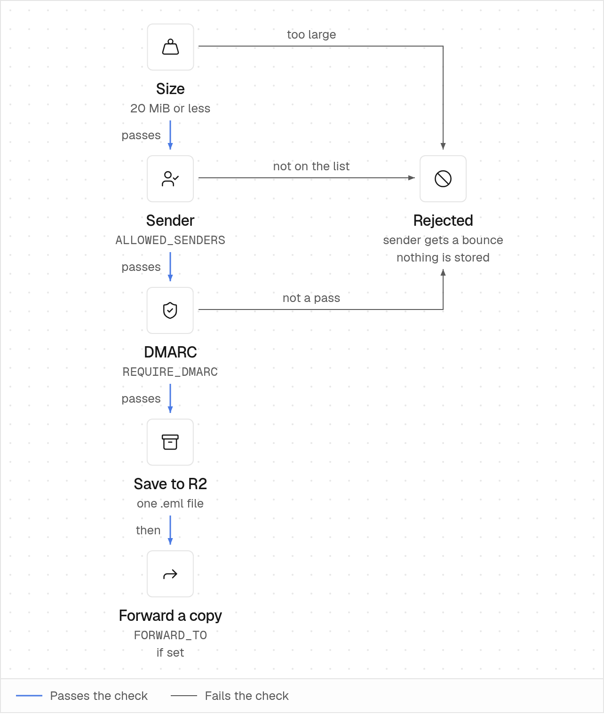

# Worker settings, storage format, and setup script options

This page lists the Worker’s settings and limits, how it stores each email in R2, and the options of the setup script and npm scripts. For task-based instructions, see [Control which emails your inbox accepts and keeps](../managing-your-inbox.md).

## Worker settings

The Worker reads its settings from `vars` in `worker/wrangler.jsonc`. All of them are optional, and changes take effect after `npm run deploy`.

| Setting | Default | Description |
|---|---|---|
| `ALLOWED_SENDERS` | Empty, so every sender is accepted | Comma-separated addresses and `@domain` entries. Mail from any other envelope sender is rejected. |
| `REQUIRE_DMARC` | `false` | When `true`, mail whose DMARC result isn’t `pass` is rejected |
| `FORWARD_TO` | Empty | An address that gets a copy of each stored email. Must be a verified Email Routing destination. |
| `PREFIX` | `mail` | The top folder for stored emails. Trailing slashes are removed. |

`ALLOWED_SENDERS` matching works like this:

- Entries are trimmed and compared without regard to case
- A full address matches only that exact envelope sender
- An `@domain` entry matches envelope senders ending in `@domain`, so subdomains don’t match
- An empty list accepts every sender

## Other Worker config

The rest of `worker/wrangler.jsonc` sets how the Worker is deployed:

| Key | Value | Why |
|---|---|---|
| `name` | `r2-mailbox` | The Worker name that routing rules point to |
| `main` | `src/index.ts` | The Worker’s code |
| `account_id` | Commented out | Set it if your login has more than one account |
| `workers_dev` | `false` | No `*.workers.dev` address |
| `preview_urls` | `false` | No preview URLs |
| `r2_buckets` | Binding `MAILBOX` to `r2-mailbox` | The bucket the Worker writes to |
| `observability` | `{ "enabled": true }` | Saves Worker logs to the dashboard |

## What the Worker does with each email

The Worker runs the same checks in the same order for every email:

1. If the email is larger than 20 MiB (20,971,520 bytes), reject it with `Message too large`.
2. If `ALLOWED_SENDERS` is set and the envelope sender isn’t on it, reject it with `Sender not allowed`.
3. Read the DMARC result. If `REQUIRE_DMARC` is `true` and the result isn’t `pass`, reject it with `DMARC check failed`.
4. Save the raw email to R2.
5. If `FORWARD_TO` is set, forward the email to it.

<picture data-diagram="worker-checks">
  <source media="(prefers-color-scheme: dark)" srcset="../images/worker-checks-dark.png">
  
</picture>

A rejection returns a permanent error to the sending server, which then sends a bounce to the sender. Nothing is stored for a rejected email.

## Limits

These limits apply to every email:

| Limit | Value | Set by |
|---|---|---|
| Largest email Email Routing accepts | 25 MiB | Cloudflare |
| Largest email the Worker stores | 20 MiB | `MAX_BYTES` in `worker/src/index.ts` |
| Metadata `envelopeFrom` and `envelopeTo` | 200 characters each | The Worker |
| Metadata `from` and `messageId` | 300 characters each | The Worker |
| Metadata `subject` | 400 characters | The Worker |

The email itself is always stored whole. Only the copies in the metadata are cut.

## Storage format

Each email is one R2 object with this key:

```text
<PREFIX>/<YYYY-MM-DD>/<ISO timestamp>-<UUID>.eml
```

| Part | Description |
|---|---|
| `PREFIX` | The `PREFIX` setting, `mail` by default |
| `YYYY-MM-DD` | The arrival date in UTC |
| `ISO timestamp` | The arrival time in UTC with milliseconds, such as `2026-11-06T21:50:24.407Z` |
| `UUID` | A random universally unique identifier (UUID), so two emails in the same millisecond get different keys |

The object body is the email exactly as Email Routing delivered it, in Multipurpose Internet Mail Extensions (MIME) format. Its content type is `message/rfc822`.

### Object metadata

The Worker attaches these fields to each object as R2 custom metadata. S3 tools show them as `x-amz-meta-*` headers, in lowercase:

| Field | Description |
|---|---|
| `received` | When the Worker stored the email, in ISO 8601 UTC |
| `envelopeFrom` | The envelope sender the sending server gave |
| `envelopeTo` | The envelope recipient, your routed address |
| `from` | The `From` header |
| `subject` | The `Subject` header |
| `messageId` | The `Message-ID` header |
| `dmarc` | The DMARC result: `pass`, `fail`, `none`, `unknown`, or another value from Cloudflare’s header |

Line breaks in header values are replaced with spaces. For what each DMARC value means, see [DMARC values](reader.md#dmarc-values).

## Setup script options

`scripts/setup.sh` reads its options from environment variables. Run it from anywhere; it changes to the repo folder first.

| Variable | Default | Description |
|---|---|---|
| `BUCKET` | `r2-mailbox` | The bucket to create. Must match `bucket_name` in `worker/wrangler.jsonc`. |
| `RETENTION_DAYS` | `30` | Days before stored emails are deleted. `0` skips the lifecycle rule. |
| `ADDRESS` | None | The address to route to the Worker |
| `ZONE_ID` | None | The zone ID of the domain `ADDRESS` belongs to |
| `CLOUDFLARE_API_TOKEN` | None | An API token with **Email Routing Rules: Edit** on that zone |
| `CLOUDFLARE_ACCOUNT_ID` | None | Needed only if your login has more than one account |
| `WRANGLER` | Pinned Wrangler, or `npx --yes wrangler@latest` | The Wrangler command to run |

The script runs these steps in order, and stops at the first one that fails:

1. Check that `BUCKET` matches `bucket_name` in `worker/wrangler.jsonc`.
2. Check that Wrangler is logged in.
3. Create the bucket, or reuse it if it exists.
4. Unless `RETENTION_DAYS` is `0`, add a lifecycle rule named `expire-<N>d` that deletes objects under `mail/` after N days. Errors from this step are ignored.
5. Deploy the Worker.
6. If `ADDRESS`, `ZONE_ID`, and `CLOUDFLARE_API_TOKEN` are all set, check that Email Routing is on for the zone and create a rule that sends `ADDRESS` to the Worker, unless a rule for that address already exists.
7. Print the remaining manual steps.

The lifecycle rule always covers `mail/`, whatever `PREFIX` is set to. If you change `PREFIX`, add a rule for the new folder yourself.

## npm scripts

`package.json` defines these scripts:

| Script | Runs | Description |
|---|---|---|
| `npm run setup` | `./scripts/setup.sh` | Create the bucket and lifecycle rule, and deploy |
| `npm run deploy` | `wrangler deploy` | Deploy the Worker with the current config |
| `npm run tail` | `wrangler tail` | Stream the Worker’s live logs |
| `npm run typecheck` | `tsc --noEmit` | Type-check the Worker |
| `npm run check` | `python3 -I reader/mailbox.py check` | Test the reader’s key and bucket access |
